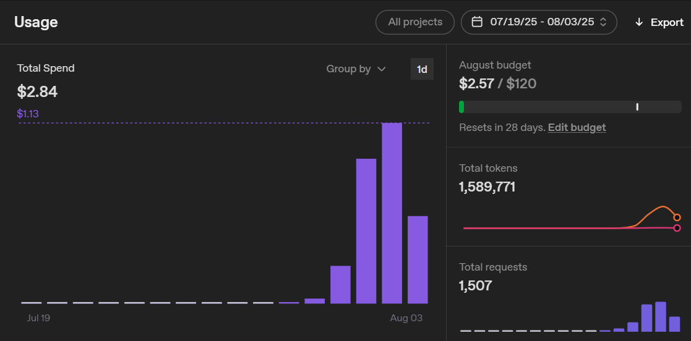

# Chemistry Agent

A multi-agent chemistry problem solver spanning **GCSE → A-level → intro-university**,
built on Claude with the Anthropic Python SDK.

Instead of one model guessing at an answer, a small team works the problem: a
**Planner** decomposes it, a **Solver** executes every calculation through real
tools, and a **Verifier** independently audits the result before it is shown —
without ever seeing the expected answer. If the verifier rejects, its feedback
goes back to the solver and the loop runs again.

```
Problem (+ optional level)
        │
        ▼
   ┌─────────┐   Plan: steps, target quantity,     ┌──────────┐
   │ Planner │──── expected units, difficulty ────▶│  Solver  │
   └─────────┘                                     └────┬─────┘
                          39 chemistry tools,           │
                          ends with submit_answer       ▼
                                                   ┌──────────┐
                      approved ◀───────────────────│ Verifier │
                         │        Verdict          └──────────┘
                         ▼          units · dimensions · magnitude · coverage
                   Answer + worked solution + cost
                         ▲
   rejected & attempts remain: feedback becomes a new user message
   (system prompt + tool list stay byte-stable → prompt caching)
```

## What it can do

- **Three difficulty tiers.** Difficulty is assessed by the planner and mapped to
  model reasoning effort, so a molar-mass lookup stays cheap while a Nernst
  equation or a Ksp common-ion problem gets deeper reasoning.
- **39 tools, no mental arithmetic.** The solver is forbidden from doing sums in
  its head; every number comes from a pure Python function.

| Domain | Tools |
|---|---|
| Stoichiometry & solutions | molar mass, moles, mass↔moles, concentration, dilution, mixing, titration, percent yield, density, empirical formula |
| Gases | ideal gas (PV=nRT), molar volume at RTP, combined gas law, partial pressures |
| Energetics | Hess's law, bond enthalpies, Gibbs free energy, q=mcΔT |
| Equilibrium | Kc, Kp |
| Kinetics | rate-law orders, Arrhenius, two-temperature Arrhenius, first-order half-life |
| Acids & bases | weak-acid pH, buffer pH, pH/pOH/Kw conversions, Ksp solubility |
| Electrochemistry | cell potential, Nernst equation, electrolysis mass |
| Reactions | equation balancer (exact integer nullspace), limiting reagent, atom economy |
| Math | unit conversion (pint), symbolic solve (sympy), safe arithmetic |

- **Tolerant scoring.** The old exact-string match is gone. A deterministic
  comparator parses quantities with pint, so `500 mL` matches `0.50 L`,
  `18.0 g mol⁻¹` matches `18.02 g/mol` within 1%, and `CH₂O` matches `CH2O`.
- **Benchmarking.** A 30-problem bank tagged by level and topic, with per-level
  and per-topic accuracy, cost, token, retry-rate, and tool-usage reporting.

## Setup

```bash
git clone https://github.com/stacyshcherbakova/chemistry-agent.git
cd chemistry-agent
poetry install
export ANTHROPIC_API_KEY=sk-ant-...
```

## Usage

```bash
# Solve one problem
poetry run chem solve "What is the molar mass of H2O?"

# Harder problem, with the full worked solution
poetry run chem solve --level university --show-work \
  "Calculate the cell potential of a Zn/Cu cell at 298 K with [Zn2+]=0.010 M and [Cu2+]=1.0 M"

# Benchmark
poetry run chem eval --limit 10 --label baseline
poetry run chem eval --level university --label uni-only

# Compare two runs (e.g. opus vs sonnet solver)
poetry run chem eval --solver-model claude-sonnet-5 --label sonnet
poetry run chem compare eval_baseline.json eval_sonnet.json
```

Library use:

```python
from chemistry_agent.agents.orchestrator import Orchestrator

outcome = Orchestrator().solve("How many moles are in 18.015 g of H2O?")
print(outcome.answer.formatted_answer, f"${outcome.cost_usd:.4f}")
```

## Development

```bash
poetry run pytest          # 349 tests, no API key required — everything is mocked
```

Architecture details, API constraints, and testing rules live in
[`SPEC.md`](SPEC.md).

## Project history

This started as a one-week experiment built on FutureHouse's
[Aviary](https://futurehouse.gitbook.io/futurehouse-cookbook/aviary) and
[LDP](https://futurehouse.gitbook.io/futurehouse-cookbook/ldp-language-decision-processes)
frameworks with GPT-4o: a single `GuidedAgent` looping over 14 GCSE tools in a
`ChemistryEnv`, scored by exact string comparison. The original reflection on
building it is kept below — the rebuild grew out of the "what could be improved"
list at the end of it.

`guided_chemistry_agent.ipynb` is retained as a record of that original version
and no longer runs against the current package.

---

### Personal Reflection on the Original Mini-Project

> *Note: Please don't take this too seriously — this is mostly to document the
> rollercoaster of emotions I experienced during one week of this project, while
> working full-time and moving houses. I'd like to do this for every personal
> project in the future.*

#### Opening Thoughts

I've worked with simple machine learning models and more sophisticated neural
nets like VAEs and GANs (using transfer learning and more), but I'd never
created an agent or used an LLM API for development before. I built my project
by referring to the Aviary and LDP cookbooks and tutorials. The frameworks had
limited documentation and few real-world examples, which made it a challenge to
understand all the available tools. That was my starting point.

#### Game Plan

1. **Define a deterministic problem.** After playing around with generating
   arbitrary text (names for people, fruit, etc.), I realised I needed a clear
   validation mechanism. Deterministic outputs would make testing and debugging
   simpler.
2. **Build a unit-conversion tool.** This worked, but general unit conversion
   proved too broad — there are endless units and edge cases.
3. **Focus on chemistry.** GCSE-level chemistry questions (molarity, density,
   etc.) map neatly to well-defined calculations.
4. **Implement tool selection.** I created a chemistry agent that chose the right
   tool for simple questions. It struggled with multi-step problems because it
   lacked context memory.
5. **Add memory with Agent State.** Following the LDP tutorial, I used
   `compute_graph` and an Agent State store to accumulate previous messages and
   reasoning steps. This was the hardest part to debug — running the agent
   repeatedly ate into my budget, but it was essential for chaining tool calls.
6. **Expand calculation capabilities.** The agent still stumbled on basic
   arithmetic in multi-step questions, so I added a generic expression-evaluation
   tool.

By the end, the agent could select chemistry-specific tools, maintain a reasoning
chain across calls, and evaluate arbitrary calculations. Which is pretty cool!!!!

#### Cost

I set a budget of **£10** (≈$13 USD), since I'd never used an LLM API before. In
total, I spent about **≈£2.14** ($2.84 USD).



#### What Could Be Improved

- **Structured reasoning steps.** Adopt a more formal plan-and-execute loop.
- **Richer toolset.** Thermodynamics, equilibrium calculations, and more.
- **Better logging.** The logs are "ugly"; print statements were more useful.
- **Enhanced rewards for intermediate steps.**
- **"Exceeded Callbacks" bug** from LiteLLM's `MAX_CALLBACKS` limit.

*(The first three are what the current rebuild addresses: the plan → solve →
verify loop, a 39-tool domain toolkit, and rich-rendered progress with real cost
accounting.)*
